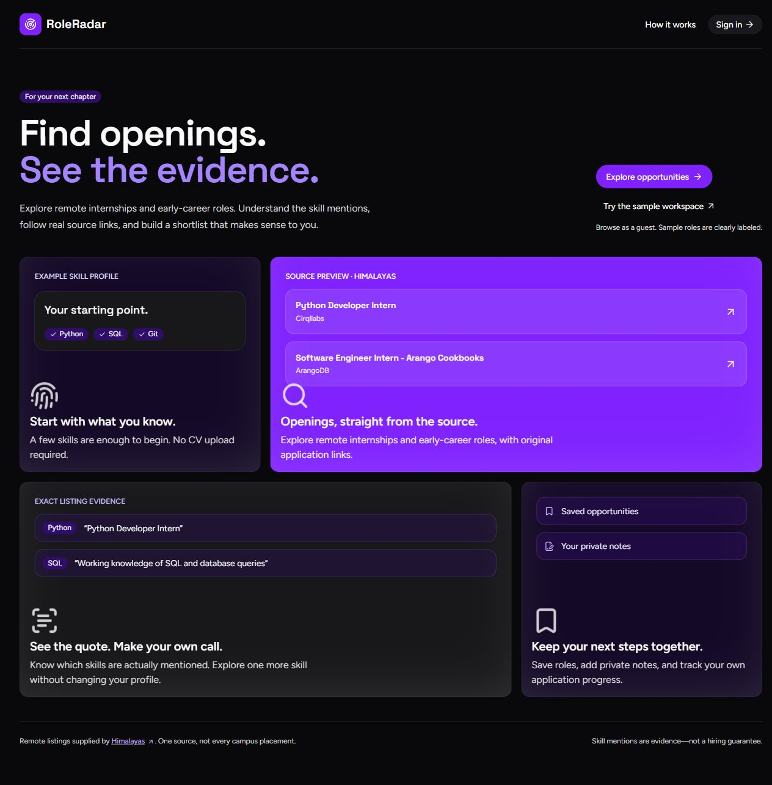
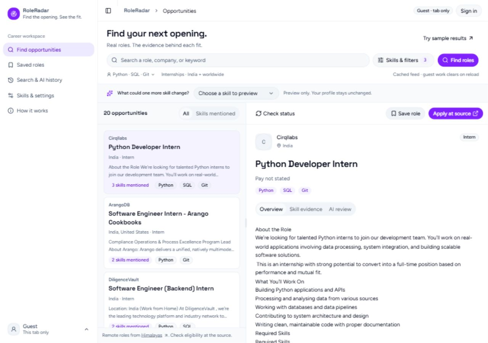
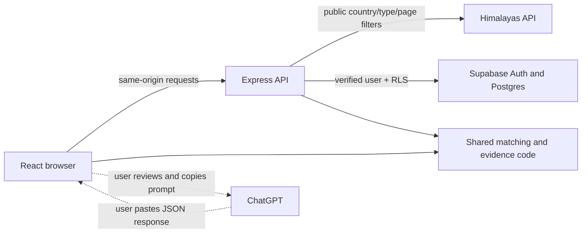

# RoleRadar

**Find the opening. See the fit.**

RoleRadar is an individual student project for exploring real remote internships and early-career roles, seeing the exact skill mentions behind each result, and keeping a private shortlist.

It was built for **SHOWCASE, the OpenAI Student Collective semester finale**, with substantial ChatGPT/Codex assistance. This repository contains the working prototype, database migrations, tests, setup instructions and the build story. It does not claim guaranteed placements, measured hiring impact or automatic AI matching.





## Why I built it

The starting concern was scarce internship opportunities for third-year students and weak placement prospects for fourth-year students. I chose a smaller problem I could build around: help a student discover existing openings and inspect why they appear relevant before spending time on an application.

The prototype focuses on **discovery and evidence**. It cannot create more vacancies, verify every employer or decide whether a student is eligible. Real student testing is still needed to establish whether this workflow saves time or reduces false leads.

## What works

- **Public browsing:** enter as a guest without creating an account. A separate sample workspace contains clearly labeled fictional roles.
- **Real source retrieval:** search Himalayas remote listings with applicant-location and opportunity-type filters. Source credit and original application links remain visible.
- **Transparent matching:** rank retrieved roles by exact mentions of selected skills, including supported aliases. Open the source sentence behind a mention. Counts are not hiring probabilities.
- **A hypothetical skill preview:** add a skill to the ranking temporarily, see which retrieved roles mention it, and inspect its evidence without changing the profile.
- **A usable job browser:** a purple bento landing page, a light workspace, a resizable desktop list/detail view, and a phone detail dialog. Filter edits stay drafts until applied.
- **Source status checks:** ask the source whether a listing is open, closed, missing or unavailable. An open response does not authenticate an employer or establish eligibility.
- **Accounts and private records:** Supabase-managed signup, login, logout and recovery interfaces; profile and skills; saved roles, notes and application statuses; search snapshots and saved AI-review exchanges.
- **Optional ChatGPT review:** inspect a prompt, copy it to ChatGPT, paste JSON back, validate exact evidence quotes, and explicitly save the exchange.
- **Data controls:** download account data or request password-confirmed deletion of the account and linked active records.

**Account readiness:** real provider login, ownership, returning history, export and deletion were exercised with disposable test accounts. Public email signup/confirmation/recovery delivery is still pending suitable SMTP and callback configuration. No public app deployment is included.

## Where AI is used—and where it is not

The job retrieval, skill matching, ranking and quote checks are **deterministic JavaScript**. There is no trained recommendation model or automatic OpenAI API call in the default app.

ChatGPT has two separate roles:

1. **Development assistance:** ChatGPT/Codex helped with product criticism, planning, architecture, implementation, debugging, test design, UI iteration and documentation. Significant code and documentation were generated and revised with that assistance; I do not claim every line was independently handwritten.
2. **An optional product workflow:** the user reviews and copies a listing-based prompt to ChatGPT, then imports its response. The app rejects invented evidence quotes. It does not prove the AI's reasoning is correct or authenticate which model produced pasted text.

The default setup requires **no OpenAI API key**. A genuine end-to-end ChatGPT review demonstration remains to be recorded. Synthetic QA responses used in tests are not presented as model output.

## How I built it

1. **Refined the problem.** Early experimentation explored placement-notice inspection. The direction changed to opportunity discovery after the concern shifted to finding internships and placements.
2. **Built a source adapter.** Retrieved public Himalayas data, normalized HTML into inert text, retained source URLs, bounded inputs/responses, and handled missing metadata, closed listings, rate limits and partial results.
3. **Made matching inspectable.** Added skill aliases and boundary-aware matching, exact quote evidence, mention-count ranking and the hypothetical-skill preview instead of an unexplained match percentage.
4. **Added private accounts.** Used Supabase Auth, verified server sessions and database Row Level Security rather than storing passwords or relying on hidden UI controls for isolation.
5. **Connected the AI-review workflow.** Added reviewed prompts, JSON import, evidence validation and explicitly saved review history without requiring a paid model API.
6. **Reworked the interface.** Used existing open-source layouts: shadcn Maia controls, login-03, sidebar-07, an adaptation of the official Mail example, and Magic UI's Bento Grid demo. Later design feedback led to the purple landing/light workspace combination.
7. **Tested and revised.** Covered source failures, matching boundaries, evidence validation, ownership and account operations. UI review also led to staged filters, responsive detail handling and a guard against a delayed status response appearing on a different selected role.

Some internal names, including `delete-scamlens-account` and the shared evidence engine, remain from the earlier prototype. They are retained compatibility identifiers, not separate current products.

Read the fuller [build story](docs/BUILD-STORY.md) and [design/source attribution](DESIGN-SOURCES.md).

## Stack and architecture

| Layer | Tools | Purpose |
| --- | --- | --- |
| Interface | React, Vite, JavaScript/TypeScript | Landing, browsing, evidence, accounts and history |
| Components | shadcn/ui Radix Maia, Magic UI BentoGrid, Tailwind CSS | Existing open-source layouts and controls |
| Icons/type | Lucide; locally bundled Figtree and Space Grotesk | Consistent icons and typography without remote-font requests |
| Server | Node.js, Express, Helmet, rate limiting | Same-origin API, source retrieval, verified sessions and account operations |
| Identity/data | Supabase Auth, Postgres, Row Level Security | Provider-managed authentication and isolated account records |
| Opportunity source | Himalayas public remote-jobs API | Source listings and current-state checks |
| Optional interpretation | User-reviewed ChatGPT copy/paste | Listing explanation with exact-quote validation |
| Verification | Node test runner, TypeScript, Vite build, SQL assertions | Local logic, integration contracts and ownership checks |



### Database

The full schema is in the two [migration files](supabase/migrations). All eight application tables have ownership policies and forced RLS:

| Table | Stored data |
| --- | --- |
| `users` | Name, email, account timestamps, linked to Supabase Auth |
| `settings` | Account preferences |
| `career_profiles` | Self-reported skills, preferred location/type |
| `opportunity_searches` | Search inputs and bounded result snapshots |
| `saved_opportunities` | Saved role snapshots, private notes and user-entered status |
| `sessions` | Saved AI-review evidence sessions |
| `messages` | Retained original inputs, prompts and imported responses |
| `results` | Local evidence results and validated imported AI results |

Linked session records bind the same owner. Account deletion cascades active application records. Provider backups/logs have separate retention.

## Run locally

Use **Node.js 24** and npm. Development was tested with Node 24.21.0. Dependencies are pinned in `package-lock.json`.

From this repository's root:

```sh
npm ci
npm run dev
```

Open **http://127.0.0.1:5173**. Guest browsing and fictional sample mode work without Supabase configuration. The public job feed still needs internet; a fresh offline process has no live catalog.

### Configure accounts (optional for guest browsing)

Copy the blank environment template once:

```powershell
Copy-Item .env.example .env
```

On macOS/Linux, use `cp .env.example .env`. Do not overwrite an existing configured file.

Keep the development defaults and set your own server-only Supabase URL/publishable key. Follow [the full setup guide](docs/SETUP.md) for migrations, the deletion function, SMTP and redirect URLs. No real keys are included in this repository. Never add provider values to `VITE_*` variables.

Use the exact `127.0.0.1` origin consistently. Switching between `localhost` and `127.0.0.1` can fail the app's same-origin checks.

### Built app

On Windows, double-click **START-ROLERADAR.cmd**. It checks dependencies, builds, and serves at **http://127.0.0.1:3001**. Keep its window open; close an earlier copy if the port is occupied.

Alternatively, in PowerShell:

```powershell
npm run build
$env:APP_URL='http://127.0.0.1:3001'
$env:PORT='3001'
$env:SERVE_FRONTEND='true'
npm start
```

On macOS/Linux:

```sh
npm run build
APP_URL=http://127.0.0.1:3001 PORT=3001 SERVE_FRONTEND=true npm start
```

The app needs an **Express/Node server** for its API. GitHub hosts the source; GitHub Pages alone cannot run this backend. Public hosting requires HTTPS, server environment variables, mail/callback configuration and host-specific network setup. The included entry point currently binds to `127.0.0.1`; a host that requires another bind address must be configured accordingly. No public-host deployment is supplied.

## Checks and verification

```sh
npm test
npm run typecheck
npm run build
```

The local suite has **53 passing checks and one skipped opt-in live test** at the last recorded run. It includes the shared auth/evidence foundation and career source/matching/route tests. The GitHub Actions workflow runs these local checks without provider secrets; the workflow itself has not run on a remote repository yet.

Historical controlled provider testing separately recorded 16 base SQL assertions, 12 career SQL assertions, nine base application integration checks and eight career integration groups using disposable accounts. These are not job-match accuracy, hiring outcomes or a real-user impact study. Do not run destructive live-account test runners against real student accounts.

See [verification](VERIFICATION.md) and the [security checklist](SECURITY-CHECKLIST.md) for exact scope and pending checks.

## Coverage, privacy and limits

- **One remote-job source:** this is not all Indian internships or an official campus-placement portal. Initial search normally fetches 20 source rows; additional pages are explicit and capped at five. Only retrieved pages are ranked.
- **Freshness:** catalog pages cache for 24 hours and opening checks for 10 minutes. Rate limits, unavailable status and partial results are disclosed. Saved searches retain at most the first 20 ranked results and are historical snapshots.
- **Eligibility:** skills and country metadata do not establish graduation year, experience, work authorization, campus access or employer authenticity. Read the source listing.
- **Applications:** the app opens the original application link. It does not submit applications; statuses are user-entered.
- **Account data:** Supabase stores identity and retained profile/history records. Other users cannot access them through the app's ownership policies; authorized operators can administer the service.
- **Sharing:** job feeds receive public filters, not names, emails, CVs or private skill profiles. ChatGPT receives text the user chooses to paste. There is no hidden analytics or remote-font service.
- **Guest/demo:** work stays in memory for the tab and clears on reload. Fictional roles have no live application links or shared cloud password.
- **Not validated yet:** three real student tests, before/after impact, public email recovery delivery, a genuine ChatGPT handoff, public HTTPS hosting and a full accessibility/device audit remain pending. The client bundle also needs future performance/code-splitting work.

Source permissions, attribution and quotas are described in [job sources](docs/JOB-SOURCES.md).

## Repository map

```text
src/                 React app, matching/evidence helpers and UI components
server/              Express API, sessions and source adapter
supabase/migrations/ Complete application schema and RLS
supabase/functions/  Authenticated self-deletion function
supabase/tests/      Controlled SQL ownership assertions
tests/               Local tests and explicit opt-in integration runners
docs/                Setup, build story, source policy, licenses and screenshots
.github/workflows/   Local-check CI workflow
.env.example         Blank configuration template
```

## Publishing this folder to GitHub

The preparation guide has the exact commands: **[GITHUB-SETUP.md](GITHUB-SETUP.md)**. Only this clean repository folder should be added; private environment files, old Git history, dependencies, build output and local tool metadata are excluded.

## Project documents

- [Build story and AI assistance](docs/BUILD-STORY.md)
- [Supabase/runtime setup](docs/SETUP.md)
- [Verification and limits](VERIFICATION.md)
- [Design sources and install commands](DESIGN-SOURCES.md)
- [Third-party notices](THIRD-PARTY-NOTICES.md)
- [SHOWCASE submission and demo kit](SHOWCASE-KIT.md)
- [Product scope and student-test plan](docs/ROLE-RADAR-PLAN.md)
- [Contributing](CONTRIBUTING.md) and [security reporting](SECURITY.md)

## License

Original application code is provided under the **[MIT License](LICENSE)**. Copied UI/template code, icons, fonts and dependencies retain their own notices; keep [THIRD-PARTY-NOTICES.md](THIRD-PARTY-NOTICES.md) and `docs/licenses/` when distributing. Job data is governed by its provider's terms, not the app-code license.
